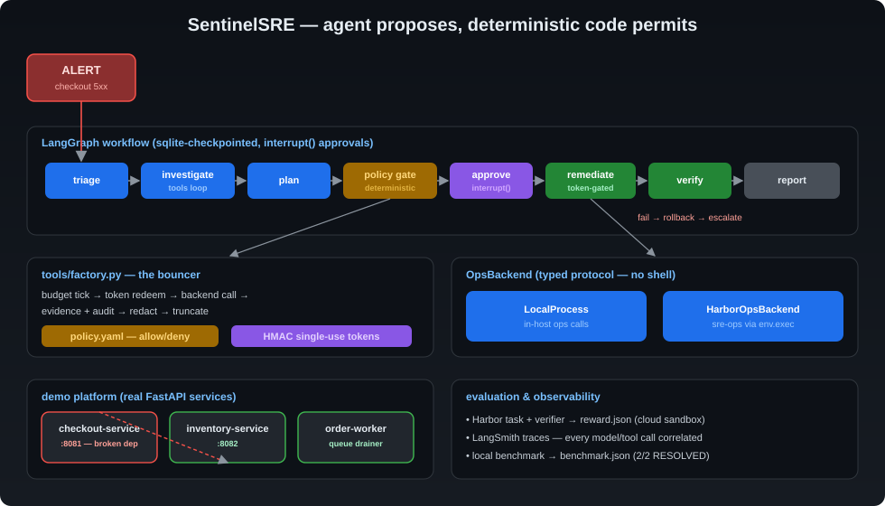
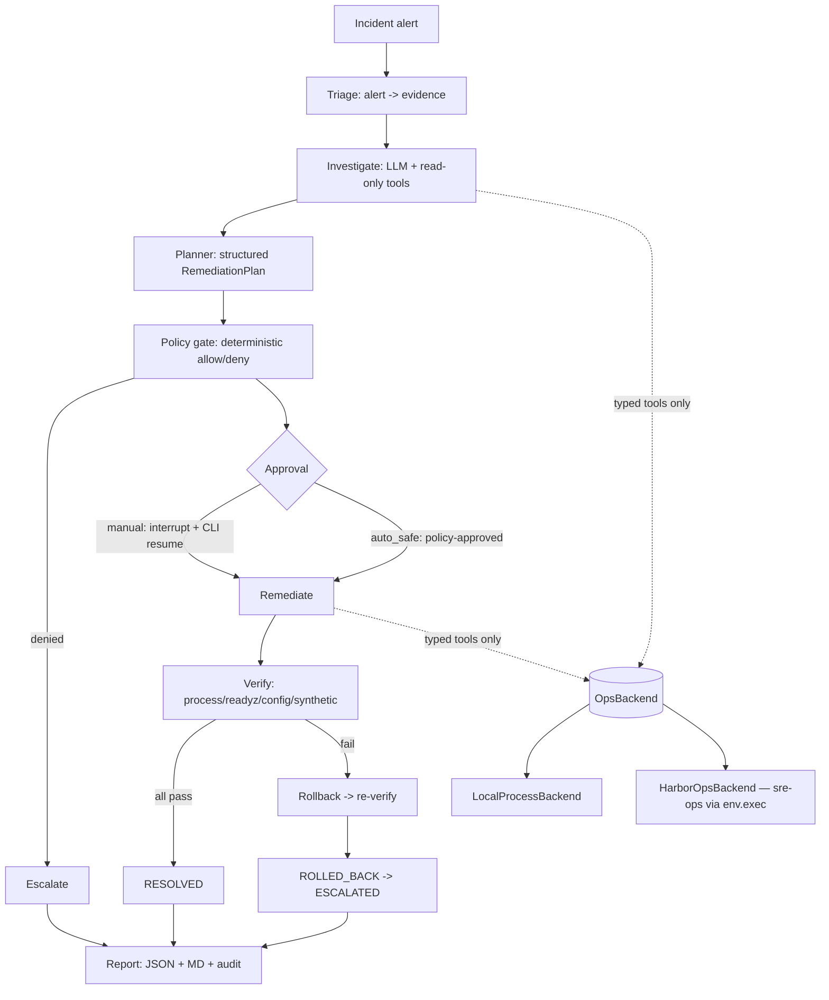

# SentinelSRE — Autonomous SRE Incident-Response Agent


> Sandboxed demo system. SentinelSRE only touches a deliberately broken
> demonstration platform. It is not connected to real production
> infrastructure, cloud accounts, or Kubernetes clusters, and should stay
> that way.

SentinelSRE is an incident-response agent. It takes an alert, investigates
the system through logs, metrics, config, dependencies, and runbooks, and
attaches each hypothesis to the evidence behind it. Then it proposes the
smallest fix it can, passes the plan through a policy engine and an approval
step, executes with single-use tokens, and checks the result with real
probes. If the fix fails, it rolls back and escalates. Every run ends with
a written incident report.

The model proposes, and deterministic code permits. The LLM never gets raw
power. It gets typed tools, a policy gate it cannot influence, and one-time
cryptographic tickets for anything that changes state.

<p align="center">
  
</p>

## Results

From executed runs of the code in this repo.

| Metric | Result |
|---|---|
| Test suite | 83 passing (unit + integration), 1 skipped (live-LLM gate) |
| Lint and types | ruff and mypy clean across 49 source files |
| Scripted benchmark | 2/2 trials resolved, about 16 s per trial, no API keys |
| Live run (Grok 4.3) | Resolved end to end: investigate, plan, policy check, token-gated patch, reload, verify, report. About 90 s wall clock |
| Harbor cloud eval (LangSmith sandbox) | Reward 1.0. Config fixed, service healthy, synthetic check passed, policy clean. About 1m41s, no exceptions |

---

## Table of contents

- [The demo setup](#the-demo-setup)
- [How a run flows](#how-a-run-flows)
- [Safety model](#safety-model)
- [Project structure](#project-structure)
- [Running it](#running-it)
- [API keys](#api-keys)
- [Evaluation](#evaluation)
- [License](#license)

---

## The demo setup

A small e-commerce platform made of real services.

| Service | Port | Role |
|---|---|---|
| `checkout-service` | 8081 | FastAPI app. Accepts orders, calls inventory |
| `inventory-service` | 8082 | FastAPI app. Stock lookups |
| `order-worker` | — | Background loop draining a file-backed queue |

Services read runtime config from `runtime/config/*.json`, write JSONL logs
to `runtime/logs/`, expose `/health` and `/readyz`, and emit a synthetic
checkout transaction used as the end-to-end probe.

The scenario `wrong-inventory-endpoint` points the checkout service's
`inventory_url` at a dead port, so every checkout fails with HTTP 503. The
platform also writes hidden ground truth to `runtime/.verifier/`, which
agent tools cannot reach, so an external grader can score the outcome.

The agent's only window into this world is `sre-ops`
(`python -m demo_platform.ops_cli.cli`): service control, logs, metrics,
dependency status, config read and patch, health and synthetic checks, disk
usage, runbook search, and platform up/down. JSON in, JSON out, allowlisted,
and audited.

## How a run flows



The workflow is a LangGraph `StateGraph` where the incident lifecycle is the
graph: triage, investigate, plan, policy gate, approve, remediate, verify,
then resolve, rollback, or escalate, and finally report.

- Investigate binds only read-only tools to the model. The LLM loops under
  a turn and tool-call budget, then must emit a structured result:
  hypotheses with real evidence IDs, a candidate root cause, and a
  confidence score.
- Plan forces a structured remediation plan: operation, target, parameters,
  risk, expected effect, verification steps, and a rollback op. Malformed
  output goes through a bounded repair loop, so a bad plan never reaches
  execution.
- The policy gate is plain code driven by `configs/policy.yaml`: op
  allowlists, risk tiers, evidence minimums, scenario overrides, forbidden
  paths. Unknowns are denied.
- Approve uses a LangGraph interrupt in manual mode. The run pauses
  mid-graph, checkpoints state to SQLite, and `sentinelsre incident approve`
  resumes it. In `auto_safe` mode, policy-approved steps get tokens
  automatically.
- Remediate binds only the approved mutating tools, so the model cannot see
  anything it was not approved for. Each call needs a minted token. A
  deterministic fallback runs any approved step the model misses, so the
  audit trail looks the same either way.
- Verify runs the plan's checks for real: process alive, readiness 200,
  config value applied, synthetic transaction passing. `RESOLVED` is only
  reachable through this node.
- Scripted mode (`--scripted`) drives the same nodes with a deterministic
  stand-in instead of an LLM. The full pipeline runs with no keys, which is
  what CI and the offline benchmark use.

## Safety model

- The policy engine decides what is safe, not the model. Anything
  unrecognized is denied.
- Each mutating call needs a single-use HMAC token binding incident, action,
  op, target, parameter hash, and expiry. Tokens are minted on the approval
  path, redeemed once, and never stored in model context.
- Evidence is content-hashed, so re-reading the same thing does not inflate
  confidence.
- The blast radius is bounded: no shell, no stop or delete, no network
  egress, no package installs. Paths like `**/tests/**`,
  `**/.verifier/**`, and `**/ground_truth*` are unreachable through tools.
- Secrets are masked and outputs are capped before they reach model context
  or logs.
- `RESOLVED` requires every verification step to pass.
- Everything is audited: an append-only `audit.jsonl` in the platform, a
  per-incident `action_log.jsonl`, and LangSmith run-tree correlation.

In testing, a plan citing fabricated evidence IDs was denied and escalated,
and a hallucinated config hash was rejected by the optimistic-concurrency
check.

## Project structure

```text
src/sre_agent/     the agent: LangGraph nodes, policy and approvals, tool wrapper, LLM layer, CLI
demo_platform/     the demo world: services, config store, sre-ops CLI, fault scenario (imports nothing from the agent)
harbor/            Harbor eval task, verifier, and job config
configs/           service registry and policy rules
tests/             unit and integration tests
```

Within the agent, `graph/nodes/` holds the pipeline stages, `policy/`
holds the engine and HMAC approval tokens, and `tools/factory.py` wraps
every tool call with budget, policy, token, audit, redaction, and
truncation handling. Backends live in `backends/`: local calls for dev,
`sre-ops` over exec for the Harbor sandbox.

## Running it

```bash
uv sync
cp .env.example .env        # XAI_API_KEY for live runs, LANGSMITH_API_KEY for tracing and Harbor
```

Zero-key scripted demo (the pipeline without the LLM):

```bash
uv run python scripts/run_benchmark.py --trials 2 --mode scripted
```

Local demo with real services as subprocesses:

```bash
uv run sentinelsre demo up
uv run sentinelsre doctor
uv run sentinelsre scenario inject wrong-inventory-endpoint
uv run sentinelsre incident run --title "Checkout failures spiking" --scenario-id wrong-inventory-endpoint --scripted
```

Live model run:

```bash
uv run sentinelsre incident run --title "Checkout failures spiking" --scenario-id wrong-inventory-endpoint --approval-mode auto_safe
```

Manual approval (the default) pauses mid-graph. Approve from a second terminal:

```bash
uv run sentinelsre incident approve <incident-id> --approver you
```

Harbor cloud eval (builds remotely, no local Docker needed):

```bash
uv run python scripts/prepare_harbor_task.py
uv run harbor run -c harbor/job.yaml --env-file .env
```

Checks, as run by CI:

```bash
uv run pytest -m "not live_llm"
uv run ruff check . && uv run ruff format --check . && uv run mypy
```

## API keys

| Key | Needed for |
|---|---|
| `XAI_API_KEY` | Live Grok runs (`SRE_LLM_PROVIDER=xai`, the default) |
| `LANGSMITH_API_KEY` | Tracing and Harbor cloud sandboxes (free tier at smith.langchain.com) |
| `OPENROUTER_API_KEY` | Alternative provider (`SRE_LLM_PROVIDER=openrouter`) |
| `OPENAI_API_KEY` | Alternative provider (`SRE_LLM_PROVIDER=openai`) |

Scripted mode, the tests, and the local benchmark need no keys. Harbor
trials use the LangSmith free tier, and the job deletes its sandbox after
each trial to save quota.

## Evaluation

Scripted baseline: `wrong-inventory-endpoint`, `auto_safe`, 2/2 resolved in
about 16 s per trial, 13 evidence records, hypothesis confidence 0.92,
`patch_runtime_config` plus `reload_service`, all verification steps green.
The benchmark writes its report to `reports/benchmark-*/benchmark.json`.

Harbor cloud trial: `harbor run -c harbor/job.yaml --env-file .env` builds
the task image on a LangSmith sandbox, injects the fault at build time, runs
the agent host-side with ops executed inside the sandbox, then grades it
with the in-sandbox verifier. Reward 1.0: config fixed, service healthy,
synthetic check passed, policy clean, in about 1m41s. Graded artifacts land
under `jobs/`, including the sandbox-side `audit.jsonl`.

The reward is the mean of config fixed, service healthy, synthetic passed,
and policy clean. Reaching `.verifier/` through ops zeroes the score.

## License

MIT. See [LICENSE](LICENSE).
